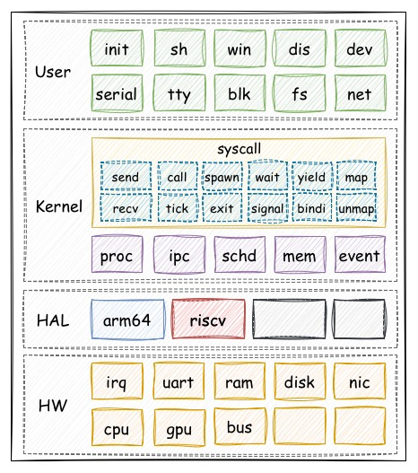

# Kernel

面向 ARM64 与 RV64 的微内核操作系统，以最小可用和高性能为目标。已接启动/DTB、物理页与预算、用户映射/封存、进程构造/调度、原生消息IPC及部分libc。普通镜像现从DTB启动包进入真正的用户态`sbin/init`，校验包目录并进入孤儿收取/CHILD事件循环；服务装载/READY、SYSTEM与设备清单、完整信号/fork/exec、文件/终端及net仍待完成，不是已可用的sh系统。



[架构设计](docs/design/00-overview.md) · [当前状态](docs/status.md) · [代码规范](docs/style.md)

使用 LLVM 工具链构建最小启动 ELF：

```sh
make ARCH=riscv
make ARCH=arm64
make unit
make fmt-check
make sdk ARCH=riscv
make sdk ARCH=arm64
make bootpkg ARCH=arm64
```

`make sdk`另生成用户态`libvirtio.a`，现含描述符管理、split ring访问层及现代MMIO探测/协商/复位；尚无生产DMA后端或实际设备队列I/O。

产物在 `build/<架构>/normal/kernel.elf`；ARM64另生成同目录的`Image`，smoke用它走标准ARM64启动协议并从x0取得DTB，ELF仍供符号/页表审计。RV64仍由OpenSBI启动ELF。`make hardware ARCH=...` 仍可单独构建保留硬件归档。
可通过 `CC`、`LD`、`AR`、`READELF` 覆盖 LLVM 工具路径；当前不支持 GNU `CROSS` profile。
构建生成 `build/compile_commands.json` 及各架构副本，供 clangd 使用；共享数据库选择最近构建的架构。
用 `make compdb ARCH=riscv` 或 `ARCH=arm64` 切换，必要时重启 clangd。共享头文件按其推断的翻译单元使用目标参数。

早期串口地址现从DTB的`chosen/stdout-path`取得，支持绝对路径与`aliases`别名，不再有QEMU固定地址回退。首次MMIO前先校验结构、窗口及寄存器属性；完整RAM/IRQ发现随后执行。固件需准备串口时钟、pinmux和波特率；控制台描述损坏时安全停止且无内核串口输出，不能由此推定已在真实板验收。详见01末尾及issue 001。

DTB解析容量现为1024节点/8192属性/32深度、每设备4个reg/16个IRQ；支持dw-apb-uart/GIC-400描述与多hart拓扑保留，启动仍受单核profile限制。`tests/fixtures/dtb`保留完整固定来源板描述、来源哈希及NEO3显式测试适配；解析通过不代表板端启动、存储/网络驱动或SMP已完成，见005和01末尾。

启动包主机工具按包内名称打包原生ELF，额外为指定init生成装载描述：

```sh
python3 tools/bootpkg.py pack --arch arm64 --init sbin/init \
  --entry sbin/init=/path/to/init.elf --entry sbin/serial=/path/to/serial.elf \
  --output build/arm64/boot.pkg
python3 tools/bootpkg.py check --arch arm64 build/arm64/boot.pkg
```

`--arch riscv`选择RV64。工具输出确定性SHA256及目录摘要；不生成缺失程序。`make sdk`另构建`build/<架构>/sbin/init.elf`，`make bootpkg`生成默认`build/<架构>/boot.pkg`，当前仅含实际实现的init，不冒充基础服务/救援清单。内核从chosen范围核验容器并只按指定init描述装载PID1。格式、预算与T1边界见07末尾。

进程启动Boot统一为格式2（144字节头），追加精确只读包VA/长度；旧格式不兼容，需重建SDK/包。ELF和堆避开16MiB包窗口；Mem仍最多64KiB。PID1获得受跟踪的R/NX分片视图，首尾包外字节隔离为0，包原页/副本只计启动保留一次，各进程页表单独计费。

生产启动现建立16个预算Set，PID1持对应CREATE SERVICE及可减权转授的自身CALL；Boot启动数据320字节，含SELF_SPACE、SELF_ALLOC和首服务CREATE，init本地表128槽。SYSTEM/设备清单、实际服务装载与READY仍待完成，详见07末尾。

`CASE=bootpkg`使用十个SDK测试包验证格式、分片/快照及拒启，不执行包内程序。`normal`必须有包；`make smoke ARCH=...`自动构建默认生产包并启动，也可传`INITRD=/absolute/path/boot.pkg`。直接运行smoke工具时可用`--init-elf`指定该包中init的ELF供独立审计。缺包/坏包在页分配前拒启；完整回归另覆盖非首目录项、整页包和包内PID1真实exit致命。

QEMU 验证使用 TCG、单核、256 MiB；ARM 固定 `virt-11.1`/Cortex-A53，RV64 固定 virt/rv64 并关闭 V/H。
启动元数据和RAM直接映射现支持最多8 GiB、最低RAM起8 GiB跨度；超限拒启，不静默裁剪。`include/layout.inc`统一内核/审计布局，设备和内核栈位于RAM窗口之后。`make test-memory`另用512 MiB、2 GiB、8 GiB在两架构各运行pages与normal，并纳入完整回归；这不是板端或性能验收。
RV64 必须通过 `OPENSBI` 指定实际的 RV64 `fw_dynamic.bin` 路径；QEMU 程序路径可用 `QEMU` 覆盖。

```sh
# 先将 OPENSBI 设为本机固件的绝对路径
make smoke ARCH=riscv OPENSBI="$OPENSBI"
make smoke ARCH=arm64
make scenario ARCH=riscv CASE=registers OPENSBI="$OPENSBI"
make scenario ARCH=arm64 CASE=fault
make scenario ARCH=arm64 CASE=pages
make scenario ARCH=arm64 CASE=guard
make scenario ARCH=arm64 CASE=budget
make scenario ARCH=arm64 CASE=spaces
make scenario ARCH=arm64 CASE=memory
make scenario ARCH=arm64 CASE=seal
make scenario ARCH=arm64 CASE=user
make scenario ARCH=arm64 CASE=switch
make scenario ARCH=arm64 CASE=stacks
make scenario ARCH=arm64 CASE=locals
make scenario ARCH=arm64 CASE=life
make scenario ARCH=arm64 CASE=procs
make scenario ARCH=arm64 CASE=prep
make scenario ARCH=arm64 CASE=syscalls
make scenario ARCH=arm64 CASE=timer
make scenario ARCH=arm64 CASE=irq
make scenario ARCH=arm64 CASE=images
make scenario ARCH=arm64 CASE=requests
make scenario ARCH=arm64 CASE=ipc
make scenario ARCH=arm64 CASE=ipcdepth
make scenario ARCH=arm64 CASE=events
make scenario ARCH=arm64 CASE=control
make scenario ARCH=arm64 CASE=terminate
make scenario ARCH=arm64 CASE=creds
make scenario ARCH=arm64 CASE=groups
make scenario ARCH=arm64 CASE=stats
make scenario ARCH=arm64 CASE=createauth
make scenario ARCH=arm64 CASE=sigreserve
make scenario ARCH=arm64 CASE=spawn
make scenario ARCH=arm64 CASE=libsys
make scenario ARCH=arm64 CASE=runtime
make scenario ARCH=arm64 CASE=elf
make scenario ARCH=arm64 CASE=init
make scenario ARCH=arm64 CASE=initfatal
make scenario ARCH=arm64 CASE=sigconfig
make scenario ARCH=arm64 CASE=sigframe
make scenario ARCH=arm64 CASE=sigsuspend
make scenario ARCH=arm64 CASE=irqchip
make scenario ARCH=arm64 CASE=irqbind
make scenario ARCH=arm64 CASE=mmiogroup
make scenario ARCH=arm64 CASE=virtiodev
make scenario ARCH=arm64 CASE=heap
make scenario ARCH=arm64 CASE=cow
make smoke ARCH=arm64 RAM=512 VIRTIO=1
make test-all OPENSBI="$OPENSBI"
# 单独验证两架构512 MiB、2 GiB、8 GiB的页回收与生产启动
make test-memory OPENSBI="$OPENSBI"
# 单独运行全部QEMU场景（不代替unit/fmt-check）
make test-qemu OPENSBI="$OPENSBI"
```

`CASE=normal|registers|fault|pages`使用独立对象/ELF。普通镜像不含测试源码，从外部包运行实际init；内核在观察到其阻塞后输出`INIT pid=...`并继续调度/IRQ空闲循环，不打印服务READY或停在测试halt。
主机测试位于 `tests/unit/`，guest测试的C/汇编载荷、入口和私有声明位于 `tests/kernel/`；构建按CASE选择链接，normal不包含测试源码。
寄存器场景检查两次陷阱之间的整数寄存器保存/恢复；故障场景核对非法指令的异常原因与 PC。
主机核对特权/中断状态与实际halt/IRQ-idle地址，再退出并回收自身QEMU。normal另逐页核对PID1 ELF代码/只读数据、全部映射/权限、栈/guard、Boot/资源、隔离包视图和实际页元数据Acct owner，并读取用户程序状态确认已校验目录并阻塞；不能只凭输出标记成功。
受限环境可用`QMP_STDIO=1 make ...`，或直接给smoke加`--qmp-stdio`，使用QMP标准输入输出管道而不创建socket监听；审计和超时/退出检查相同，result记录实际传输方式。默认仍为本地Unix socket。
默认超时10秒；`CASE=timer|irq`使用25秒，验证真实10秒固定准备期限。失败保留串口、QEMU 输出、命令、符号及结果。需要异常 trace 时加 `TRACE=1`。
`RAM=128|256|512` 改变实际QEMU内存，`VIRTIO=1` 添加virtio-rng设备；normal只发现传输窗口；virtiodev另固定附加RNG并验证用户态协商/复位，尚不进行队列或业务I/O。
启动解析实际DTB，输出RAM、保留区、可用页和支持设备的窗口/中断；主机独立核对，并保存guest收到的runtime.dtb。
`CASE=pages` 实测伙伴分配的各阶物理读写、地址/对齐约束、普通耗尽后8页COW容量兑现、独立保护低水位及全部归还；元数据自身从实际RAM预留，未启动用户映射或进程计费。
`CASE=budget` 验证稳定账目、普通额度、真实块归属、失败回滚和关闭后滞留/代次复用，另验证COW额度/物理承诺双重预留、子兑现与关闭父的旧页转交。账目代码已可供内核接入，尚无运行进程、exec峰值或COW承诺；normal不创建模拟进程来冒充这些功能。
`CASE=spaces` 验证用户根页清零、借用且保护内核高半区、页表计费、256槽耗尽、引用/代次和关闭后回收；测试始终在内核态，不代表已进入EL0/U态或验证了用户硬件访问。
`CASE=memory` 验证普通DATA逐页清零、跨页表映射失败回滚、独立管理/映射引用及整条解除。当前每次最多16页，普通DATA只允许同Acct的R/RW映射；CODE封存后可R/RX。无SHARED/DMA或原生用户授权入口。
内核切到高半区后撤销低地址映射；代码RX、只读数据R、普通数据/栈RW且不可执行，两个栈guard均不映射。串口单独映射，ARM使用Device-nGnRnE属性，RV64使用设备PMA。
权限故障场景为 `textwrite`、`rodatawrite`、`dataexec`、`guard`、`null`、`identity`、`alias`、`unmapped`，分别验证只读、不可执行、空洞、低地址撤销及解除映射后的物理页复用。它们会产生预期panic，由主机核对原因、PC及故障地址。
主机从QMP导出全部有效页表到 `tables/`，逐页检查RAM范围、权限、设备属性、固件排除、guard及无额外别名。构建ELF仍使用物理装载地址，高半区运行地址见串口VM记录。
`CASE=seal` 验证写别名拒绝封存、封存后写路径拒绝、真实新代码执行及完整回收。`CASE=user` 使用64 KiB用户栈和只读Boot头，验证U/EL0整数/FP初始清零和往返，以及Boot/CODE只读、内核隔离、栈guard/NX；它不是ELF加载、csu、init或原生syscall实现。
`CASE=switch` 验证112字节内核切换现场、独立guard栈上两次挂起/恢复、被调用者保存寄存器及栈回收；完整时间片/阻塞调度仍未接入。
`test-all` 运行主机测试、格式检查、两架构五十个基础场景及四个RAM配置，共一百零四个QEMU场景；任一步失败即失败。`bench` 尚未实现并明确失败。
`CASE=stacks` 验证默认64个计费内核栈、独占叶表、分步失败回滚、续点持有/切离后回收与观测水位；user场景也已迁到独立计费栈，完成陷阱后切回CPU启动栈再回收。
`CASE=locals` 验证128槽、授权子窗口/减权、封存及独立引用，并覆盖固定镜像CALL/NOTIFY入口、复制及旧入口失效/释放；`life`验证默认256份保留结果、运行槽复用和清理引用；`procs`验证默认63个普通运行槽（槽0保留给初始init）、构造失败回滚、发布前复查、两个真实U/EL0入口以及退出后CPU分批回收。这些构造场景为可信内核/测试接入，未提供原生create/start/grant/wait。
`CASE=prep` 验证父通过准备权为孩子Acct分配、临时映射发布屏障、旧加载权失效及取消后的费用滞留；`CASE=syscalls` 则通过三个真实用户程序验证自身内存syscall、协作yield/FP保持、动态代码执行及unmap后硬件故障，不使用测试陷阱回调；也检查真实硬件计数推进及time/getres寄存器结果。
`CASE=timer`让两个无主动syscall的忙循环经真实timer IRQ轮转，验证10秒准备到期、旧临时映射滞留及最终回收。可信CPU入口可启用约5ms用户时间片；内核IRQ全现场、CPU空闲唤醒及自身alloc受控窗口已接，IRQ只请求检查点调度。`CASE=irq`验证内核整数/FP现场、开IRQ/WFI边界、独立空闲到期/回收及真实原生分配检查点；尚无IRQ嵌套、通用长Op或完整阻塞调度；ARM缓存仍关闭。这套检查不代表完整操作系统、调度、真实硬件缓存、完整IRQ、性能或CI验收。

每个内核C单元生成`.su`编译帧报告，镜像目录`stack-usage.json`汇总；仅统计各函数帧，不代表完整调用链/汇编或最坏栈深证明。
构建记录在 `build/<架构>/manifest.json` 及各镜像目录，最新尝试结果在 `last-run.json`，逐命令日志在 `runs/`。
QEMU 记录在 `build/<架构>/smoke/<运行编号>/`，包含构建快照、实际 QEMU 版本/参数及固件 hash。
`make clean ARCH=...` 清理对应架构及指向它的共享编译数据库。

`CASE=images`验证512槽耗尽、构造准入失败回滚、已取消镜像号不复用及旧Life/镜像保留时的新PID隔离；它是可信生命周期机制测试，不是用户态exec或完整原生创建/观察实现。

`CASE=requests`验证Rq预付/恢复保底、948份真实DRAINING占池、构造回滚、取消/ACK及双方死亡后的邮箱/运行索引复用；这是可信机制，原生IPC、阻塞/事件、资源回复及DMA安全确认尚未接通。

`CASE=ipc`使用真实用户程序验证原生call/send/recv/reply等、阻塞续点、等待环、元数据和FP保持、服务死亡后的原RPC/独立收尾；`ipcdepth`使用WAIT_DEPTH=1验证DEPTH边界。通信入口由可信测试预装，完整管理授权、资源reply、信号和运行库仍待接入；事件接续见下条。

`CASE=events`由真实用户程序从固定CONTROL调用connect生成通信入口，再检查消息/事件交替、筛选与合并、notify授权、重设/取消/混合TIMER代次及CPU空闲中真实未来闹钟；`ipc`同时验证RQ_DONE/RQ_CANCEL和独立收尾提示。CHILD提示接续见spawn；LIFE可靠观察接续见creds；仍无外设IRQ投递或信号运行库。


`CASE=control`通过真实用户程序检查固定CONTROL的grant/revoke、源GRANT与目标INSTALL分别校验、精确来源排队撤销、ACCEPTED仍可回复、已存在Mmap保留、旧目标退出/运行槽复用隔离及inherit标记。本control场景只测固定进程CONTROL，CONSTRUCT原生路径见spawn；EXEC_VIEW及完整fork/exec仍待实现。


`control`另验证固定CONTROL BUDGET、单实例费用限额与分配反馈；`CASE=terminate`覆盖就绪/阻塞/回复后READY/自身强制退出、等待Rq引用解除与DRAINING保留、正常退出首因、原Acct关闭及旧CONTROL/运行槽复用隔离。STOP和完整信号仍待接；创建接续见spawn。


`CASE=creds`检查原生getcred的自身/CONTROL QUERY/真实REQUEST及CHILD准备归属，以不同非零uid/gid验证旧来源退出/运行槽复用、DRAINING读取和证明释放后的STALE。Life现128字节；测试构造身份由可信内核显式设置，该场景当时未接CREATE身份准入，后续见spawn；FUTURE exec准备及FS仍待实现。


`control`另覆盖query RESOURCE的自身/固定CONTROL只读范围、分页与Local代次游标、最大16条及跨页输出、陈旧目标/故障缓冲不部分写入。其他query种类接续见下，准备表只读范围见creds场景说明。


`control`另覆盖query ACCT/LIFE的实际费用/预算、退出原因和收取责任；`prep`核对旧运行槽回收后仍保留费用的Acct身份，最后别名释放才结清。Life128字节，不因保存账目身份延长Acct存活；集合索引只是诊断标签。


`ipc`/`ipcdepth`另验证query RQ的自身/固定CONTROL范围、责任位/阶段、非消费、旧服务退役记录和真实收尾后的可见性；查询不授予请求操作权或代替DMA安全确认。


`CASE=groups`验证原生getpg/setpg/setsid的自/子同会话授权、0选择器、uid 0无豁免、保留组号与会话首进程限制，以及组长退出/运行槽复用后的完整PGID/SID保留。未包含成功exec后的禁止改组、终端前台或STOP/CONT；自动孤儿接管的可信机制验证见life，真实用户init场景仍待接。


`creds`另以只有CONFIG的CONSTRUCT原生query RESOURCE读取孩子真实SELF_SPACE/SELF_ALLOC记录，核对目标PID/image/Handle，并拒绝其他query种类、只读输出和仅CONFIG时调用ALLOC。EXEC_VIEW/exec及完整用户装载仍未接入。


`CASE=stats`验证原生PROC查询的实际状态、组关系、费用、资源/映射/Rq数量及调度计费，阻塞目标不因其他进程忙循环而计费，旧CONTROL与运行槽复用隔离。CPU累计包含选中窗口内用户/内核及IRQ开销，不是硬件性能测量；STOP/终端/SYSTEM和完整exec仍待接入。


`CASE=createauth`以可信内核入口验证固定Set的CREATE、三代上限减权、独立授权引用/回滚和pending=1/2的即时接收保底。该早期场景不是原生create，后续身份/SERVICE准入见spawn、Sigctx见sigreserve；普通用户ELF装载接续见elf；完整文件装载/exec仍待接。


`CASE=sigreserve`验证Proc构造的两层信号现场预付、早/晚失败回滚、实际用户exit后的离栈释放，以及旧镜像仍保留时新PID/运行槽复用隔离。每份Sigctx低于1024字节，另验证单调cookie跨PID/镜像复用不重置；该场景聚焦预付，实际原生注册/用户帧/sigreturn见sigframe，STOP/CONT仍待实现。


`CASE=spawn`使用真实用户程序调用create、为孩子分配/装载CODE/栈/Boot、CONFIG grant、configure/start并完成IPC和exit；验证凭据/限额、三准备与满表失败回滚、SERVICE两输出槽、别名发布屏障及destroy续点被另一用户terminate后的回收。CREATE权由可信fixture安装，孩子结果由真实用户父通过原生wait收取，覆盖阻塞/WNOHANG、PID/任意孩子/冻结组选择、重复收取CHILD错误及CHILD事件；不是ELF/csu/POSIX spawn或生产init清单发权验收。

`creds`另验证原生observe/obsread/obsnext/obsack/obsdrop：SOURCE/CHILD的真实REQUEST关联、MONITOR显式CONTROL QUERY、合并LIFE、DRAINING与证明释放、旧cookie不跟随槽复用及观察者死亡回收；含OBSERVE原生grant的准备期配额安装。host覆盖每服务128/系统1024预付、表满终态枚举、撤权后既有记录和cookie代次耗尽。测试permit由可信fixture安装；生产清单、真实exec/FUTURE和FS业务清理仍待接。

`make sdk ARCH=...`输出sdk/中的公共头、私有桩头、库/启动对象及测试ELF，另输出sbin/init.elf和独立链接清单。libsys自身不反向依赖libc/fs/net，审计未解析符号；编译单元合入compile_commands.json。`CASE=libsys`仍用独立测试ELF验证内存/IPC与回收；normal只从包执行实际init，不链接这些fixture。完整服务清单仍待接。

SDK现另输出crt0.o、libc.a和runtimeuser.elf，常规程序按crt0.o/app.o/libc.a/libsys.a链接；自定义入口仍可仅用libsys。`CASE=runtime`两架构各验证10份真实main镜像，包括可写参数/环境、构造与清理顺序、32个atexit用户槽、exit/_exit、畸形或未支持Boot拒绝及完整回收。基础libc仅声明已实现接口，已接基础malloc/calloc/realloc/free，stdio流/文件适配及线程TLS仍未接；fd/Fix启动内容暂以127退出，normal尚未启动生产init。

`CASE=elf`由真实用户C程序通过libsys解析嵌入的完整静态ELF，原生create并为孩子逐页装载、写入真实SELF Boot、configure/start，最终wait孩子main退出42；孩子仅3启动资源槽，父表只留1临时槽也可装载。另验证预算/源读取/VA冲突/坏Boot回滚及完整回收。私有elfcheck/load/clean在SDK中供运行时和init复用，尚非完整posix_spawn/exec，也未接FS稳定文件来源或生产init清单。

`CASE=init/initfatal`仍是独立测试ELF，覆盖三代孤儿接管、权限与真实PID1致命退出。normal则从真实外部包装载sbin/init，包内exit另由tests/packageboot.py验证；服务清单/设备授权及READY监督尚未完成。

libsys场景另验证原生__sys_copy：最多64KiB、物理别名重叠拒绝、只读/封存目标和非法范围FAULT、设备属性拒绝及unmap后失效；无需临时页。当前单核复制全程保持IRQ屏蔽/VM_BUSY，未测最长屏蔽时间，尚未接COW/信号/文件I/O包装，不宣称其性能或完整POSIX缓冲处理。

基础libc现提供getpid/getppid、wait/waitpid及sys/wait.h状态宏。elf场景验证真实退出42、WNOHANG不写status、只读status在收取后返回EFAULT且结果不重复；init场景验证父查询跟随孤儿接管。STOP/CONT只接编码，实际事件与信号中断/重启仍待实现，不宣称完整POSIX或异步安全验收。

init场景另覆盖组wait的BLOCKED和结果唤醒READY两种续点被CONTROL terminate：保存的组lease释放，活孩子与未消费退出结果归init，常规wait宏识别强杀信号9。扩展后总收取7个后代，保留init费用/组引用精确回到基线；没有把管理terminate当作已实现sigsend/STOP。

SHARED内存已接原生alloc和受权跨Set grant/map，默认SELF_ALLOC为DATA/SHARED/CODE。libsys两架构场景使用两个Set验证子窗口共享写、撤权后既有映射保留、原出资进程清理/收取后仍保留3页旧Acct费用，以及接收者最后unmap才结清。私有DATA/CODE仍不跨Acct，SHARED不可执行/封存；资源reply、DMA和fork/exec共享继承仍未接。

configure现可为镜像预付0..8个资源回复保底空槽；CALL_RECV_MEM/CALL会在入队前优先借保底、再借普通空槽。libsys真实载荷验证满表、QUEUED取消归还、ACCEPTED取消保留及普通回复归还；terminate另验证调用者强杀回收。资源reply安装仍待Resreply指针参数位置确认，REPLY_RESOURCE仍NOTSUP，不将空槽预留当作资源已交付。

类型化资源提交核心现可将SHARED MEM/CALL USE安装到原请求预留槽，ACK不回收资源、重复查询不重装。libsys两架构以可信CPU桥提交冻结描述符，验证真实调用者的异步MEM/同步CALL kind=4与可用授权；桥不是原生reply解码，REPLY_RESOURCE仍因参数位置待确认而NOTSUP。

`CASE=sigconfig`验证原生DEFAULT/IGNORE、CHLD NOCLDWAIT、掩码与初始配置，6个真实孩子覆盖旧结果保留/后续自动收取和继承/重复configure；结束动态页/配额/信号预付归零。原生HANDLER由sigframe/sigsuspend验证，RESTART/NOCLDSTOP仍NOTSUP；真实信号来源、发送、STOP/CONT和普通等待中断/重启仍待接。目标仍包括net。

sigreserve场景另检查信号Hctx的HAL转换/恢复边界：拒绝特权/IRQ/诊断篡改和非法FP控制、失败不写输出，恢复后的GPR/FP/NZCV实际进入U/EL0验证。该场景只核对HAL转换；原生HANDLER、用户帧/cookie/最上层检查和sigreturn由sigframe验证，细节与证据见11末尾。

基础libc另已提供C locale的strtol/strtoul，支持2..36进制、自动八/十/十六识别、精确endptr和范围错误；不依赖fs/net。runtime场景每架构5个真实main共核对275组/550次转换，并保持原启动/退出和资源清理检查；当前子集与证据见08/15末尾。

stdio.h现另提供内存snprintf/vsnprintf的整数/指针/字节字符串与字符子集，支持宽度、精度、常用长度修饰及截断长度计数。runtime每架构新增120项实际格式检查；完整格式列表与错误边界见08/15，流printf/FILE仍待文件适配。

unistd.h另提供getpgrp/getpgid/getsid/setpgid/setsid，直接使用完整64位PID及已实现的内核组/会话规则。runtime每架构新增105项实际检查，CPU独立核对会话变更与关系回收；错误及限制见08/15，kill/raise和完整作业控制仍待信号路径。

CASE=irqchip验证GICv2/PLIC实际UART请求的控制器认领、屏蔽、完成、设备清理后重开及timer共用，ARM另验证SGI0；CPU IRQ始终关闭，属于HAL轮询验证。原生IRQ绑定/驱动事件递送尚未接，实际timer IRQ场景仍为timer/irq，详见01/05末尾。

CASE=irqbind另验证可信安装后的真实外设IRQ到用户EVENT、原生ACK/CONTROL解绑、旧Handle/消费边界、无timer忙伙伴进展及镜像结束回收。IRQ_SOURCE授权和原生irqbind仍待05的撤销语义确认，0x70继续NOTSUP；测试硬件清理由可信UART桥提供，用户MMIO/生产serial仍未交付。

irqbind载荷另经可信库存取得独占UART页，实际用户态Device映射读写/清状态后ACK；普通copy/seal/EXEC被拒绝，删除Cap后映射到最后unmap仍有效。同Set不同Acct不能同时映射同窗口；共页virtio及生产MMIO发权仍待接，详见09末尾。

CASE=mmiogroup验证显式完整成员整页权限、ARM8个共页virtio窗口的实际用户Device读取、跨Acct拒绝及最后unmap后的交接；RV独占页复用同一租约。启动显式force-legacy=false并严格读version=2，尚无队列/DMA或块/网络业务I/O，详见09末尾。

CASE=heap验证构造函数及外部VA冲突、128个小块与跨Mem大块、表满realloc失败保留旧块，以及进程仍活着时全部堆页/费用回到基线。分配器按需链接，无FS依赖；SDK链接脚本提供隐藏__image_end供默认堆选址，自定义脚本须保留该契约。零长分配与realloc(p,0)采用最小分配，仍须free返回指针；fork/信号前置集成见08/15，尚未完成。

sigframe现由11个用户进程自行原生注册handler/trampoline，新增注册后解除代码映射的受控失败；sigsuspend的9个进程同样自行注册并使用libc等待。signal.h支持集合助手及mask/pending/suspend，来源仍是可信code=0测试注入；公开POSIX sigaction trampoline、真实来源编码与Rctx/普通等待中断仍待接。

spaces场景在活动root上完成64次叶换页/权限更新且不申请页表页；rodatawrite预热RW翻译再降R，核对真实写权限故障。

CASE=cow使用8分支配置验证预付、Mem克隆/回滚、跨Space全部别名提交及真实用户COW写故障。四组覆盖父/子先写、父退出与真正只读拒绝，含原生RW map/free、整数/FP/条件码现场；普通RAM耗尽后仍兑现承诺并保留低水位。用户COW计数为14，内核copy分离单独验证。

测试进程由可信fixture独立构造，尚非原生fork。现另接内核spacewrite/copy的完整COW预检与PA刷新，并在普通RAM耗尽后验证原生copy兑现；sigframe另验内核帧跨入共享COW栈页且影子栈保持全零。fork发布/继承及完整信号前置仍待接通，详见02/11末尾。

seal现另验两代封存代码视图共用规范backing、中间Acct即时回收、原出资者退出后代码仍真实执行返回42，以及最后映射结清。immutable视图不增加代码物理页/COW承诺；完整父Space快照和fork发布/继承事务仍待接通。

CASE=cow现另验证整个Space映射快照：私有DATA按Mem去重、代码SEALED共享和显式SHARED可见性，后段失败恢复父保护/接管记录并清空孩子。快照只覆盖已提交映射；Local原Handle/墓碑和HAL子现场已有独立验证，可信Proc/Prep准备与取消已有组合验证，原生准入/检查点/专用提交及运行库Fix尚待接通。

locals现另验可信fork资源表继承：原Handle值、SELF/私有Mem重绑定、SHARED/代码动态权限、CREATE减权和未继承墓碑，包含未映射Mem视图；两架构实际写及最终回收独立核对。Space/Local/Signal/现场现有统一内部快照；可信Proc/Prep准备与取消已接；原生fork准入、分批检查点、专用提交和Fix仍待接。

sigframe现另验fork信号银行快照：保留动作/mask而清pending、两层孩子cookie与父帧隔离、父cookie拒绝及COW SP的逻辑可写恢复。新增组合检查在内核中恢复生产Hctx，不执行真实子fork返回；原11个用户信号场景继续验证实际handler/sigreturn。原生fork的Proc/Prep事务与运行库Fix仍待接。

sigreserve现另验HAL派生的fork子返回现场：两架构各运行零Fix和只读标记两个用户续点，核对系统调用后首条指令、整数/FP状态及getid。原始陷阱现场由可信fixture合成；标记不是运行库Fix，原生forkprep/commit/abort及统一准备事务仍未接通。

sigframe现另验统一内部forksnapshot：Space、原Handle资源表、未映射Mem、保底、信号和HAL现场纳入同一次提交/后段回滚。两架构各四组可信组合覆盖两层cookie及后段信号/容量失败；不执行真实原生fork，可信Proc/Prep准备及取消现已接入；原生准入、分批检查点、Fix和专用发布仍待接。

sigframe现另验带独立内核栈的可信Proc/Prep fork准备：普通start/configure拒绝，显式取消、期限边界、源关闭、准备容量和READY父被强杀均核对清理。父退出在延迟清理前立即撤销未发布孩子的资格，父先回收时旧账目仍保留到孩子最后视图结束。原生fork三个调用仍NOTSUP，尚无完整分批检查点、Fix与专用发布。

fork接管账本随临时DATA视图保留，最后引用自动撤回新原页接管，原管理者/root/Acct可先退出；临时Mem管理引用由目标Local表持有，隐藏准备行保留旧目标代次，成功才提交父谱系，普通有界drain可在源表关闭后独立释放。映射结束/回滚游标现内嵌Prep，独立持两个root及Prep引用，取消后仍可分批结束，每次孩子叶移除与父PTE恢复合计最多32个。Prep256字节，池增12KiB；Mem96及Local48不变。sigframe覆盖接管/表持有及分批结束、取消后租约与实际PTE上界。调度/STOP/KILL转交仍待接，当前同步IRQ屏蔽，不跨调度，原生fork尚未开放。

映射构建现也按同一Prep记录分批推进：源/PTE预检、别名检查与逐页保护、视图去重和孩子映射安装，每次最多32个扫描/页工作单位；中途取消或失败走已有回滚，固定记录/池不增长。sigframe另验完整构建提交、部分保护取消和真实额度失败。未映射/Local/Signal组合长循环及调度检查点仍待接，当前不得在批次之间开放IRQ或执行其他VM工作。

私有DATA额外别名root现另持独立冻结租约（每root一次，只读别名也参与），结束按批解冻；Proc/Prep资格撤销后的资源清理等待冻结事务结束，避免先拆Local或root。sigframe真实Proc组合验证等待、回滚后继续清理和最后别名结清，固定池不增长。完整原生fork检查点尚未接，不能任意丢弃构建栈。

可信fork构建者现可显式把取消事务交给CPU清理：prepwork按32槽批次先释放孩子表，再逐批回滚映射/保护，最后解除克隆阶段；源表先关闭仍可完成，已开始提交拒绝反向移交。sigframe覆盖64槽目标表及真实Proc最终清理，固定池不增。STOP/CONT及原生fork检查点尚未接，不把内部移交当成已支持用户fork。

可信fork续点现可登记后在内核root切出/恢复；固定CONTROL终止挂起者或暂停者自行退出会先移交CPU回滚，原栈不再恢复。sigframe专用用户边界wrapper验证真实Proc/Hkctx调度和终止回收，normal无wrapper；指定测试PID不执行用户指令。无自动IRQ窗口、STOP/CONT、任意无关VM进展或原生fork检查点，完整fork仍未开放。

映射保护日志现只链接本事务冻结的Mmap，容量检查用实时空闲计数，跨批不保存无关全局映射链或空闲链节点；小池host及两架构续点peer另验15次独立Mem映射增删/复用和后段容量失败，固定池不增。同一源Mem的别名准入/引用变化、自动检查点及其他fork长循环仍待收口。
