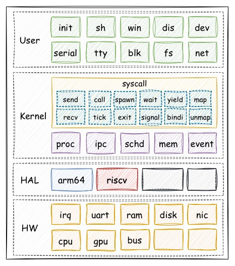

# 整体架构与阅读顺序

[设计总览](00-overview.md) · [实现状态](../status.md) · [执行与验收](#执行与验收)

状态：2026-11-15设计审查修订已写回；两架构物理启动与早期异常诊断已实现并在QEMU局部验证，其余系统机制、性能和CI仍待执行，不称全系统已验证。

先读本篇，再按下列顺序阅读。顺序由底层机制走向用户态服务；并列服务按需阅读，文档编号不表示运行时只能单向调用。

1. [硬件、Arch 与 HAL](01-hardware.md)
2. [内存、地址空间与预算](02-memory.md)
3. [进程、权限与调度](03-process.md)
4. [IPC、请求与共享通道](04-ipc.md)
5. [事件、中断与时间](05-events.md)
6. [系统调用 ABI 与模块边界](06-abi.md)
7. [init、启动与服务管理](07-boot.md)
8. [程序装载与用户态运行库](08-runtime.md)
9. [设备驱动与 DMA 恢复](09-devices.md)
10. [文件描述符、VFS 与持久化](10-filesystem.md)
11. [终端、会话与信号](11-terminal.md)
12. [网络服务](12-network.md)
13. [显示、输入与 PTY](13-graphics.md)
14. [诊断、关机与系统验收](14-operations.md)
15. [POSIX 源码兼容范围](15-posix.md)

IPC、调度和事件是协作机制，fs 与设备服务通过异步协议协作；循环的运行交互不等于允许源码依赖环。最终规则归各主题文档，审查修订已归入对应主题；实际状态以 status.md 为准。

审查修订和反例验收已归入各主题文档；方案修订不代表代码已实现或运行验证通过。旧实现已从当前分支删除，不兼容旧 ABI。
本组文档记录方向、执行项和需要决定的问题；不能用旧 QEMU 结果证明新设计。

本组文档按用户最新架构图统一整理层次、职责、接口和执行顺序。首版串口MVP的接口决策、数值/布局及容量已在各主题首版规格冻结；网络/图形扩展仍单独排期。

普通进程操作由调用者、内核与资源所属服务直接协作；init 保留系统策略、引导、服务监督与全局恢复。

## 架构总览

采用用户最新架构图，表示目标结构，尚未实现；图中接口的实际归属以正文为准。
图中的 dev 现确定为 init 内部设备管理模块，不要求独立进程；保留上传原图不作修改。



最新图将 HAL 与 Arch 分层：HAL 表达 IRQ、CPU、内存和设备资源等硬件抽象，Arch 表达 arm64/riscv 的具体实现。
HAL 公共契约放在 `include/hal/`；Arch 实现仍放在 `kernel/arm64/`、`kernel/riscv/`，不新增 `arch/` 中间目录。
两层都是实现边界，不是新增运行态或服务进程。图中的 UART/Disk/NIC/GPU 表示硬件抽象类别，
不表示把这些设备驱动或协议搬回内核；内核只提供必需的控制器/CPU/映射/授权机制，设备协议仍由 serial/blk/net/dis 等用户态服务处理。
用户态驱动使用获授权的设备资源及适当的底层访问封装，不要求每次设备读写都通过 syscall 或内核 HAL 中转。
图省略物理硬件层、共享数据通道及直接 MMIO/DMA 连接；实际依赖仍是抽象接口落到架构/设备实现。
HAL 不需要强制为每个图标建立一套通用接口；IRQ/页表等内核契约与用户态设备封装的具体划分仍需逐项定义。
RISC-V 当前仅支持 RV64。图中 syscall 名称是概览，实际接口分层以[系统调用 ABI 与模块边界](06-abi.md)为准。

## 已确定的命名约定

名称简短、职责明确，优先常见词和可理解的缩写，不加 `srv` 后缀。
程序、目录和文件名使用小写：`init`、`sh`、`win`、`dis`、`serial`、`tty`、`blk`、`fs`、`net`；`dev` 为 init 内部模块名。
dis 已确定为显示服务，替代旧 print，不再设置独立 print 服务。
文档叙述可用 FS、TTY；引用具体程序或路径时使用小写原名。
具体代码命名规则以 [代码风格](../style.md) 为准。
这些命名约定已确定；以下架构细节仍按各节标注讨论，不代表服务已经实现。

## 已确定的源码布局

公共代码直接放在各自根目录，架构代码直接使用架构名，不增加 `arch/` 中间层，不设置独立 `platform/`。

```text
kernel/                 # 公共内核机制
├── arm64/              # ARM64 硬件实现
└── riscv/              # RISC-V 硬件实现（当前仅 RV64）
include/                # 公共头文件
├── arm64/
└── riscv/
lib/                    # 用户态启动对象和公共库
├── csu/                # 启动对象，含 arm64/riscv 入口
├── libc/
├── libsys/
│   ├── arm64/
│   └── riscv/
└── libvirtio/
bin/                    # 普通命令：sh、cat、ls、ps
sbin/                   # 系统服务：init、serial、tty、blk、fs、net、dis、input、win
tools/                  # 主机端构建和镜像工具
tests/
docs/
```

目录按 RISC-V 架构家族命名，当前目标仍为 RV64，不表示已支持 RV32。
未来支持 RV32 时共用 CSR、屏障等可复用机制；寄存器保存指令、上下文布局、ABI 和页表按实际差异处理。
少量位宽差异可用宏，Sv32/Sv39 等差别较大的实现再拆文件；现在不提前实现 RV32 分支。
ARM64 目录统一叫 `arm64`，工具链或 QEMU 的参数仍按工具要求使用 `aarch64` 等名称。
设备树描述硬件资源，不能替代寄存器操作；CPU、定时器、PLIC/GIC 在对应内核架构目录，普通设备驱动在用户态。

### 用户态源码与产物（已确定）

普通命令各有 bin/<程序名>/ 目录，系统服务各有 sbin/<程序名>/ 目录；dev 是 init 内部模块。
lib/libc 提供 C/POSIX 接口、stdio、分配器和 errno 转换；lib/libsys 提供内核接口、用户态服务适配及 Boot 低层辅助；lib/libvirtio 提供用户态 virtio 公共代码。
libc 可依赖 libsys，libsys 不依赖 libc，其基础模块不要求 fs/net 在线；启动代码只初始化必要环境，避免服务启动依赖环。
公共库静态链接且按需链接；架构适配跟随所属模块，例如 lib/libsys/arm64、lib/libsys/riscv，不保留顶层 user 目录。
用户态 MMIO/屏障公共封装归 lib/libsys 对应架构目录，设备协议仍归驱动或 libvirtio，不依赖内核 HAL。
源码不照搬 usr.sbin 等安装路径层次，运行时 /sbin、/bin 等由镜像安装清单决定，不由源码目录隐式决定。
两架构产物分离，例如 build/arm64/sbin/init.elf；打包工具按清单选择进入启动镜像或文件系统的程序。
init 源码编译为独立用户 ELF，再由构建工具生成启动装载描述并打包；嵌入启动镜像不改变其用户态执行和地址空间隔离。
启动镜像携带基础驱动/fs 等程序，由 init 加载；内核只按已校验装载描述启动首个 init，不从磁盘读取或通用解析全部 ELF。
骨架仅建立公共库和程序分类目录，不创建各服务占位入口冒充实现。

## 范围与原则

第一版：单核、RISC-V 64 与 ARM64、每进程一个线程和独立地址空间。
驱动、文件系统、终端及服务恢复在用户态。支持进程管理、同步 RPC、共享内存与 IRQ 事件。
Unix 程序创建改为纳入 fork 与配套 exec 设计，不再限制为仅 spawn。fork 复制当前执行环境，exec 在保持进程身份下替换程序；posix_spawn 保留为便利/优化接口，不强制内部先完整 fork。
此项是范围调整，地址空间复制、在途 IPC、继承权限及原子发布的详细规格仍须冻结，不能据此声称已有 fork/exec 或完整 POSIX。
不做多线程、任意动态权限委派、通用对象派生、多核、优先级和实时保证；IPC仅允许CALL绑定、双方同意的单SHARED MEM/后端CALL回复交付。
减少必经操作与状态组合，不以源码行数或未经测量的性能倍数作为目标。

## 全局不变量与冻结条件

各主题的修订规则和反例验收须一起满足；容量由编译配置给出，不能用方案文本代替运行验证。

### 修订范围与冻结条件

保留单核、每进程单线程、编译容量、寄存器短消息、明确 syscall、伙伴分配、无通用堆、用户态设备协议和静态 ELF。
调整单出站槽、满额停止接收、init 同步等待、单 PTE W/X、立即取消即复用的假设。成本是有界请求/事务/结果记录，不用无界堆或泛化对象框架替代。
直接交接使用捐赠的剩余时间预算，不重置，耗尽则普通轮转；一次调度选择/事件循环/Op 推进均有配置上界，实测公平性和延迟。
本轮同时实现会话/进程组、信号安全点、停止继续、前台切换；不以单 PID 强杀冒充作业控制，不宣称完整 POSIX。

阶段 00 的剩余工作是将本节状态转换、容量关系、共享结构和 syscall 编号落成一致规格，并完成下列验证；不是再选择是否修复上述问题。

- [ ] 请求排队/接收/回复/取消/收尾/确认所有交错的状态机检查。
- [ ] 小容量下 init、fs、tty 控制路径和结果清理的有界进展检查。
- [ ] 事务每步失败、组启动中 Ctrl-C/退出、封存别名与内存耗尽的守恒检查。
- [ ] 两架构运行反例场景和完整回归，记录实测延迟，不用方案文本冒充验证通过。

本次设计检查记录：临时 Rq 抽象模型枚举 10 个可达状态、12 条转换，检查终结结果不被晚到回复改写、finish 与 ack 均满足前不复用。
另检查长期名额为 1–7 时保留即时分发名额的队列进展；该模型假设服务对即时消息有界处理，不是任意服务的活性证明。
临时模型不是内核实现，也未验证硬件、缓存顺序、真实调度或信号栈；对应实现测试仍全部待执行。

## 本轮冻结范围与证据边界

2026-11-15用户授权按助手判断一次收口剩余设计。本轮决定了：最小权限和继承、观察接口、fork/exec准备与信号端点、Boot/Fix/Trapframe布局、原生调用号/错误/固定结构、初始容量/费用、文件/终端/启动协议、关闭保底及exec/SIGCHLD兼容取舍。各篇正文与首版规格共同构成当前唯一实现目标，旧ABI不兼容，实际实现变更需同步设计而非留双分支。

尚未取得完整POSIX.1-2024在线正文，首版明确公布poll控制EIO/timeout0控制延迟、exec跨服务窗口、嵌套exec及输出FAULT等限制，不声称标准合规。未知硬件/性能只能通过真实验证确定，不把设计选择叫实测结论。net/input/win/dis扩展的线协议不作为串口MVP前置，不预留假实现。

此前全部冻结的判断已撤回：7项及本轮交叉复核均已写回，复核又补齐自身查询、信号前置/首次子修复、后台容量和磁盘回收格式的衔接，不等同阶段00全部验收。这些协议的证据仍是文档、固定布局/容量及有限模型检查，运行实现后须补真实故障场景与双架构验证。阶段01构建及阶段02物理启动/异常诊断的实际交付见01及status；已合并的PR不等于后续代码获得自动提交或推送授权。

## 执行与验收

各主题按勾选记录执行进度，实际结果记录在 [status.md](../status.md)。阶段编号是执行依赖，不要求与文档编号相同。

### 通用规则与测试入口

下表是统一入口约定；测试命令和脚本路径中尚未存在的部分仍须后续建立。
当前fmt-check、unit、两架构启动ELF、smoke及registers/fault场景可用，test-all聚合这些已实现检查；bench仍失败。可用范围见01，不能视为后续功能已交付。记录完成情况统一在 status.md，并附日志位置及对应版本。
每阶段记录：代码完成情况、host 测试结果、RV64 QEMU 结果、ARM64 QEMU 结果、CI 结果、已知限制。
禁止以编译成功、单个 PASS、旧分支结果或未运行的 CI 替代验收。

拟统一构建参数：ARCH=riscv（RV64）与 ARCH=arm64，交叉工具链前缀由 CROSS 单独指定。
阶段01最小切片已实现LLVM参数，非空CROSS明确拒绝；目录家族名不改变编译器目标和 QEMU 程序名。
拟建立入口：

| 入口 | 用途 |
| --- | --- |
| `make fmt-check` | 公共/两架构 C、头文件格式 |
| `make unit` | 主机可运行的算法、协议、失败注入测试 |
| `make ARCH=riscv` / `make ARCH=arm64` | 分离输出的两架构构建 |
| `make smoke ARCH=...` | 有超时的基础 QEMU 启动与机器可读结果 |
| `make scenario ARCH=... CASE=...` | 指定交互、故障或恢复场景 |
| `make test-all` | 全部已实现测试、两架构 smoke/scenario，失败不得跳过 |
| `make bench ARCH=...` | 正确性通过后的独立基准，不作为正常启动自测 |

场景测试由主机控制串口与 QEMU，使用明确的阶段握手和超时；超时、意外退出、FAIL、缺少预期结果均失败。
不仅匹配输出，还校验退出码、文件内容或资源快照，避免固定打印 PASS 冒充功能。
每个场景使用独立磁盘副本；持久化场景明确复用同一镜像重启，其他场景不得相互污染。
故障时保存完整串口、构建参数、随机种子、QEMU 版本与必要 trace；禁止只留最后一行。
每阶段只新增验证真实不变量的测试，不为目录重命名或简单包装逐项造测试。

### 阶段 00：冻结关键设计决策

- [ ] 产物：资源/进程身份编码、管理者权限、RPC/事件/退出状态机、内存预算规则、服务协议草案。
- [ ] 完善[IPC 阻塞模型](04-ipc.md)有界延迟回复方案和取消通知；将已选的显式状态机细化为具体状态转换与陷阱契约。
- [ ] 列出授权撤销、调用者/服务死亡、代次耗尽、预算不足及设备未完成时的返回/清理规则。

测试方法：逐步演算双进程调用、三层调用、tty 等待输入但仍需输出、init 等待子进程但仍需处理请求、
每个 RPC 阶段任一进程死亡、检查与订阅间发生事件、身份复用。记录每一步状态和资源所有者。

验收：每种等待都有正常完成和取消路径；每块资源有唯一计费规则及回收条件；上述场景无未定义转换。
未决定的问题不得伪装为默认行为；此阶段通过的是设计审查，不是 QEMU 功能实现。
