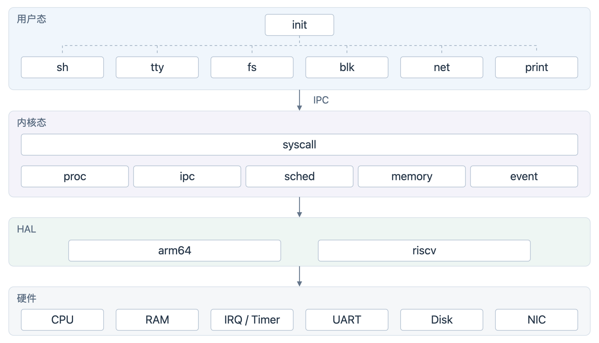
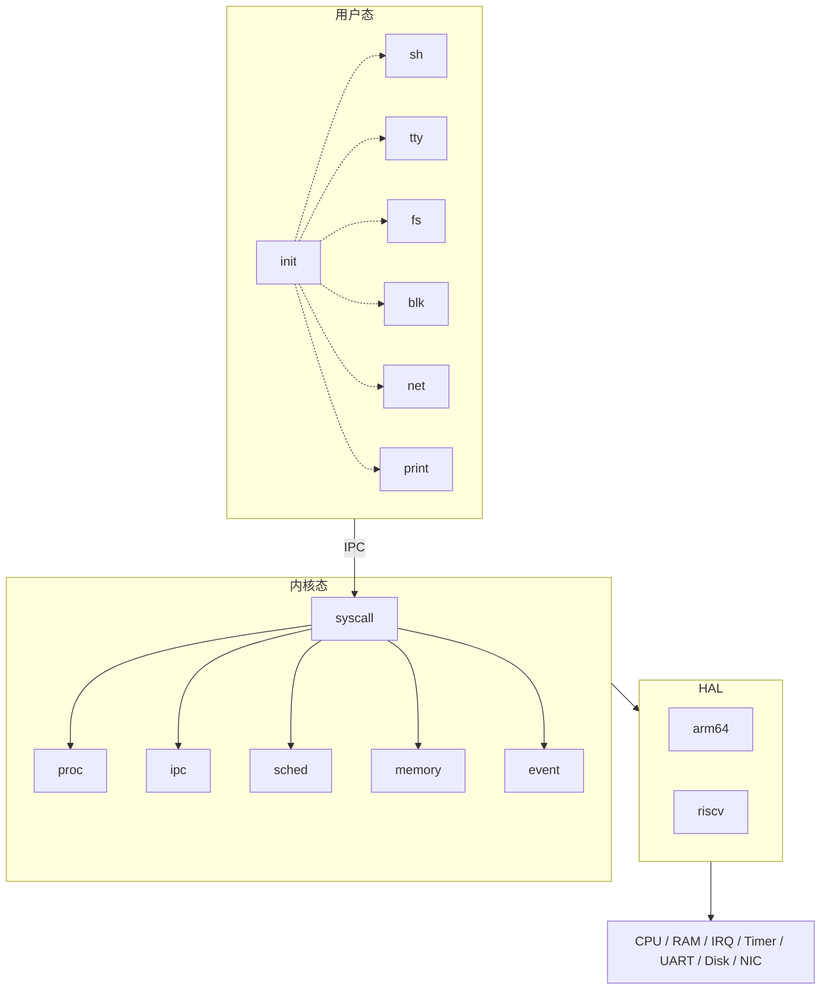

# 最小可用、高性能微内核：设计讨论

状态：候选方案，尚未实现。旧实现已从当前分支删除，不兼容旧 ABI。
本文记录方向、执行项和需要决定的问题；不能用旧 QEMU 结果证明新设计。

本文统一记录内核机制与系统可用性。服务的阻塞读/等待问题须先解决，再确定请求与事件协议是否足够。
首版 IPC 包含 call、send、recv、reply_recv；具体 ABI 与阻塞服务协议仍待确定。

## 架构总览

以下为目标架构，尚未实现。图中的服务间箭头表示逻辑通信关系，实际控制消息均通过内核 IPC。



[SVG 原图](images/architecture.svg)



HAL 是内核机制与硬件操作之间的接口边界，实现在 `kernel/arm64/`、`kernel/riscv/`，
公共契约放在 `include/hal/`；不是独立进程，也不要求新增 HAL 实现目录。
图中省略共享内存及用户驱动直接访问授权 MMIO/DMA 的连接；这些访问不经过内核 IPC 数据搬运。
HAL 只封装内核必需的硬件操作，不接管 tty/blk 的设备协议。RISC-V 当前仅支持 RV64。

## 已确定的命名约定

名称简短、职责明确，优先常见词和可理解的缩写，不加 `srv` 后缀。
程序、目录和文件名使用小写：`init`、`fs`、`blk`、`tty`、`sh`、`net`、`print`。
文档叙述可用 FS、TTY；引用具体程序或路径时使用小写原名。
具体代码命名规则以 [代码风格](style.md) 为准。
这些命名约定已确定；以下架构细节仍按各节标注讨论，不代表服务已经实现。

## 已确定的源码布局

公共代码直接放在各自根目录，架构代码直接使用架构名，不增加 `arch/` 中间层，不设置独立 `platform/`。

```text
kernel/                 # 公共内核机制
├── arm64/              # ARM64 硬件实现
└── riscv/              # RISC-V 硬件实现（当前仅 RV64）
include/                # 公共头文件
├── arm64/
└── riscv/
user/                   # 公共用户态代码和服务
├── arm64/              # 用户态架构适配
└── riscv/
```

目录按 RISC-V 架构家族命名，当前目标仍为 RV64，不表示已支持 RV32。
未来支持 RV32 时共用 CSR、屏障等可复用机制；寄存器保存指令、上下文布局、ABI 和页表按实际差异处理。
少量位宽差异可用宏，Sv32/Sv39 等差别较大的实现再拆文件；现在不提前实现 RV32 分支。
ARM64 目录统一叫 `arm64`，工具链或 QEMU 的参数仍按工具要求使用 `aarch64` 等名称。
设备树描述硬件资源，不能替代寄存器操作；CPU、定时器、PLIC/GIC 在对应内核架构目录，普通设备驱动在用户态。

## 1. 范围与原则

第一版：单核、RISC-V 64 与 ARM64、每进程一个线程和独立地址空间。
驱动、文件系统、终端及服务恢复在用户态。支持进程管理、同步 RPC、共享内存与 IRQ 事件。
不做多线程、动态权限委派、IPC 传资源、通用对象派生、多核、优先级和实时保证。
减少必经操作与状态组合，不以源码行数或未经测量的性能倍数作为目标。

## 2. 权限与资源

每个进程包含地址空间、调度/IPC 状态、事件位图和有上限的扁平资源表。
只有可信管理进程创建进程、建立映射和配置授权。普通服务只使用授予的资源。
表项记录类型、对象标识和权限；用户只能传整数句柄，不能传内核指针。
句柄须识别代次，防止槽位复用导致旧句柄访问新资源，耗尽不得回绕复用。
删除 CNode 用户对象、两级 CSpace、Copy/Mint、badge 派生、IPC 能力传递及通用 INVOKE 框架。

待决定：句柄位宽/编码；每进程表容量；管理者权限边界；撤销对已有映射与阻塞操作的语义。
授权撤销和对象销毁必须分别定义，不把代次检查当作资源回收协议。

## 3. 同步 RPC

第一版直接向获授权的目标进程调用，不设独立 Endpoint 对象。
一个进程是一个接收者；每个调用者最多一个未完成出站调用。
首版操作：call、send、recv、reply_recv。send 为同步单向发送，异步提示仍使用事件位。
服务最多处理一个入站请求，但处理期间可同步调用下游：init → fs → blk。
回复关系存于内核调用状态，不作为可复制资源暴露。
只能回复当前请求；调用者死亡后旧回复不得投向复用后的进程。
目标死亡取消排队及等待回复的客户端；每次重建均产生新身份，旧句柄不得静默指向新服务。

待决定：固定消息机器字数量与寄存器 ABI；内核可信来源标识；返回错误；reply_recv 遇到失效调用者时的精确语义；
嵌套调用中上游死亡的处理；是否拒绝可检测的调用环；接收事件和请求的公平性；超时不纳入首版。
应用协议仍可能死锁，必须明确不保证通用死锁自由。

### 同步 send（已纳入首版）

`send(target, message)` 使用与 call 相同的目标句柄、发送授权和固定长度消息格式。
接收者收到消息后发送者返回成功，不等待业务处理结果，不产生回复关系。
没有接收者时发送者阻塞；消息保存在发送者进程的出站记录中，不新建异步缓冲池。
每进程仍最多一个未完成出站操作，send/call 复用该记录及目标的 FIFO 等待队列，不越过先到的请求。
接收者必须从内核返回的消息种类区分 SEND、CALL 与 EVENT，用户消息不能伪造该元数据。
仅 CALL 建立 current 回复关系，SEND 不占用回复记录；对 SEND 不能执行回复。
reply_recv 在没有当前 CALL 请求时不能伪造回复，应返回明确状态错误；接收 SEND 后通过 recv 继续接收。

成功只表示消息已交付，不表示业务操作已执行或持久化；业务确认应使用 call。
发送者进入就绪态前必须完成消息复制；目标在交付前退出则 send 失败，交付后退出不追溯改变成功结果。
发送者排队时退出须摘除队列节点；已交付消息是独立快照，不因发送者退出而失效。
发送授权撤销对排队消息的处理必须与 call 统一，在权限设计阶段明确。
send 不解决服务持有 CALL 时不能接收其他请求的问题，也可能形成同步等待环。

## 4. 数据与共享内存

短控制消息通过寄存器，路径和大块数据走预建立共享内存。
RPC 热路径不分配内存、不临时映射、不传权限；队列节点嵌入进程结构，FIFO 常数时间入队/出队。
共享数据仍需边界检查及必要快照，不能信任其他进程不会并发修改。
块驱动先保留私有 DMA 缓冲，不要求端到端零拷贝。

待决定：通道共享缓冲布局、长度与所有权；多客户端隔离；断连后缓冲何时可复用；共享内存映射授权。

## 5. 内存与预算

候选：移除用户可见 Untyped/Retype；采用可回收物理页分配器和管理者配置的进程预算。
私有页计入所属进程，退出统一释放；共享内存单独记录映射引用，最后解除引用时回收。
设备页只能来自启动发现的授权资源，普通 RAM 不能伪造硬件权限。
不用通用内核堆：控制结构用有上限的专用池，页表和数据用页分配器。

待决定：页分配算法、连续页/DMA 需求、元数据和页表计费、共享页由谁承担费用、预算转移、分配失败原子性；
私有页变共享的规则；映射持有和进程死亡清理顺序。不得同时维护新旧两套用户内存模型。

## 6. 进程生命周期

创建中 → 就绪 ↔ 运行；运行可阻塞，完成等待后就绪。
任一存活状态 → 退出中 → 已退出 → 回收；阻塞原因独立记录。
配置完整前不得入运行队列；退出后拒绝新请求；取消等待后再拆资源关系。
在安全的调度器栈上回收执行栈和地址空间；退出结果不能因进程槽复用而串线。
共享资源按真实引用回收，设备 DMA 未停止不能回收相关页。
用户态管理者决定重启和重新连接；不自动重放失败的文件写操作。

待决定：创建/启动事务、退出等待与事件投递、父进程死亡、孤儿回收、退出记录生命周期；
阻塞系统调用用栈续点还是显式状态机（关系到每进程内核栈和清理复杂度）。

## 7. IRQ 与事件

IRQ 仅投递给已授权接收者，事件位可合并，不当作次数计数。
控制器认领/屏蔽/完成留在硬件层；驱动清设备状态后确认，按硬件要求重新开放。
待决定：事件位分配、IRQ 与普通通知是否共用接收入口、丢失与合并语义、接收者死亡时 IRQ 屏蔽与资源处置。
没有 IOMMU 时设备驱动属于可信域；设备重启需要单独的停止/复位协议。

## 8. 调度与性能

候选：FIFO 就绪队列、轮转时间片、reply_recv 合并陷入、接收者等待时直接交接。
交接须计入时间片，不能让 RPC 服务链绕过其他就绪进程；须定义嵌套调用的预算归属。
同地址空间不重复切页表，批量映射统一刷新 TLB。
ASID、多核、异步共享环及零拷贝先不做。

验收既检查正确性，也测短 RPC 往返、饱和吞吐、共享数据传输、排队公平性及内存占用。
当前用户要求先讨论，尚不运行性能测试；QEMU 数值不代表真实硬件性能。

## 9. 模块边界

- proc：构造、授权、退出与回收。
- sched：就绪队列、时间片、运行目标选择。
- ipc：调用、接收、回复、取消。
- event：事件位、IRQ 投递与确认。
- memory：物理页、预算、共享内存。
- vspace：映射、页表、安全访问。
- syscall：ABI 解码和入口检查，调用具体机制。
- HAL（include/hal 公共契约、kernel/arm64 与 kernel/riscv 实现）：CPU、页表、定时器和 PLIC/GIC 等内核必需硬件操作，不感知服务协议。
- kernel/boot：解析设备树并整理启动资源；普通设备协议由用户态驱动处理。
- include/{arm64,riscv}、user/{arm64,riscv}：架构专用头文件和用户态架构适配。

具体 API、系统调用编号、地址布局和数量上限尚未确定，禁止先写成已定 ABI。

## 10. 执行入口

按第 19 节的阶段顺序实施，每步均有产物、测试与验收条件；未通过前不宣布该阶段完成。
第 11–18 节说明需求边界，不代表已经交付。
完整旧实现保留在本地旧基线 fdbe99b 及工作区外归档中，不上传至新仓库；提取硬件操作不能重新带入旧 ABI 或对象模型。

## 11. 基础进程与启动闭环

用户态基础组件：`init`、`tty`、`blk`、`fs`、`sh`；目标架构另纳入 `net` 和 `print` 服务。
`net` 负责网络；`print` 的具体职责、设备后端及两者的协议/实现阶段待讨论，不因加入架构图而宣称已实现。
`init` 负责进程/资源管理、加载程序及启动依赖，不拆独立内存管理、注册中心或恢复服务。
内核只启动 `init`；基础服务镜像由启动镜像携带，挂载后普通程序从文件系统加载。
服务必须完成 READY 握手后才能启动依赖者；失败有明确错误，不能无限等待伪装成启动中。
基础镜像清单、依赖关系、预算和授权集中配置，明确 `init` 故障为首版致命错误，不宣称可自恢复。

- [ ] 建立启动镜像、依赖顺序、就绪握手和失败处理。
- [ ] 明确硬件资源发现、保留内存和设备授权；未知设备不授予任意物理访问。

## 12. 程序运行环境

提供用户态 crt 启动入口、最小 C 运行库、系统调用桩和统一错误码。
候选加载格式为静态 ELF：校验文件范围、段范围、溢出、对齐、重叠、入口权限和零填充区。
代码和数据分别映射，避免默认 RWX；内核代码/数据及设备属性也应正确区分。
定义用户栈、argc/argv、环境变量、启动资源布局；加载完成前不允许运行。
提供 spawn/wait/exit，首版不要求 fork、动态链接或完整 POSIX exec 语义。

- [ ] 定义程序入口 ABI、静态链接脚本和加载失败回滚。
- [ ] 支持参数、退出状态及用户态可控内存申请/释放，规定配额和失败结果。
- [ ] 提供 memcpy/memset、字符串、整数格式化和基础输入输出，不依赖完整 libc。

## 13. 文件描述符和路径

整数 RPC 资源句柄与文件描述符是不同概念；文件描述符表示一次打开的文件/终端及其读写状态。
候选：用户态库维护有上限的 fd 表，0/1/2 为标准输入/输出/错误，后端为 fs/tty 会话。
跨进程继承应由管理者和服务显式建立或复制会话，不能直接把父进程的本地句柄当成子进程句柄。
定义 open/read/write/close、偏移、EOF、短读写和错误语义；关闭和进程退出不能泄漏服务会话。
当前目录由用户态管理，定义相对路径、根目录、`.`/`..`、路径长度与目录枚举。
共享缓冲按连接隔离或明确定义串行使用，不能让多个进程相互覆盖请求。

- [ ] 定义 fd 表、标准流和 spawn 的继承/重定向协议。
- [ ] 支持文件读写、创建、删除、目录列表和当前目录；确定截断/覆盖写的持久化边界。
- [ ] 清理进程死亡后的打开文件、连接和共享缓冲。

## 14. 控制终端与交互

已确定：tty 管理终端实例，init 为 sh 指定控制终端，子命令默认继承，系统服务默认无终端。
控制终端独立于标准流；重定向输出不改变控制终端，终端标识本身不授予权限。
单串口首版支持回显、退格、行读取、换行处理和原始字节输出；定义输入缓冲满时的行为。
进程查询可返回终端标识供 ps 显示，终端身份复用也不得把旧关联指向新实例。

- [ ] 明确谁维护控制终端元数据、谁授权访问、终端关闭如何唤醒读取者。
- [ ] 提供可用的中断/终止前台命令方式，否则死循环程序只能重启系统。
- [ ] 若增加 Ctrl-C，明确最小前台目标及终止语义；不据此宣称具有完整信号/会话/作业控制。

## 15. 必须先解决的阻塞模型问题

现有候选 RPC 要求每服务最多一个入站请求，且回复后才能接收下一个请求。
若 tty 持有 sh 的阻塞读请求，子程序随后请求输出，会被该读请求挡住；单纯说“加事件”不能解决这一点。
init 若在 spawn 请求里同步等待子进程退出，也可能无法继续处理子进程的管理请求。

必须在实现前选择并写清：用户态服务采用非阻塞 read/wait + 就绪事件，还是允许有界的延迟回复记录。
前者要有原子的检查/订阅或等价协议以免丢唤醒；后者必须定义请求身份、上限、取消和回复生命周期。
暂不通过增加线程或为每个操作拆服务规避这个问题，也不把加入 send 当作阻塞服务协议已解决。
sh 执行外部命令后应释放输入读取，避免与子进程争抢输入。

- [ ] 用“等待终端输入时另一个进程输出”和“等待子进程时处理其他请求”检验 IPC/事件方案。
- [ ] 定义请求、事件的公平性和背压，不使用忙轮询代替阻塞。

## 16. 时间与故障观测

内核提供单调时间、定时等待/唤醒；墙上时间和时区不是首版必需。
sleep 的定时唤醒不等于 IPC 超时；不能把超时当成磁盘请求或 DMA 已取消。
提供受控进程快照：身份、父进程、名称、状态、阻塞目标、CPU 用量、内存用量和控制终端。
用户异常只终止故障进程，记录原因及故障地址；内核 panic 必须输出可定位的信息。
早期诊断不依赖 fs/tty 正常工作，正常日志可先走 tty，不新增 log 服务。

- [ ] 实现单调时间、sleep、ps、内存用量查询和故障记录。
- [ ] 限制查询和调试接口权限，不泄漏内核指针或其他进程私有内容。

## 17. 可用工具和持久化闭环

sh 支持参数解析、引号、外部命令、退出码和基础重定向，不要求完整脚本语言。
最小工具集：echo、cat、ls、pwd、cd（sh 内建）、mkdir、rm、ps、kill、sleep、内存用量查询。
工具可共享实现，但首版至少有一个从磁盘加载的独立可执行程序，不能全部由 sh 内建冒充程序加载。
文件系统写操作要有明确崩溃一致性和 flush 语义；未完成的写不能自动重放。
退出系统前停收新写入、完成已提交事务并同步；关机/重启由授权管理者发起。

- [ ] 明确磁盘格式和最小恢复策略，验证断开服务后重新挂载；不直接把旧 KFS 视为已移植。
- [ ] 提供 sync、受控 shutdown/reboot 及对应固件操作。

## 18. 第一版验收与后续边界

- [ ] 两架构启动至 sh，终端行编辑和输入输出正常。
- [ ] 从磁盘启动带参数的程序，继承标准流和控制终端，父进程取得退出码。
- [ ] 完成 ls/cd/cat、创建/写入/读取/删除及输出重定向，重启后数据符合持久化承诺。
- [ ] 一个程序忙循环或异常时，其余进程仍可运行，能查询并终止目标。
- [ ] 连续启动/退出及失败加载不泄漏页、句柄、会话或退出记录。
- [ ] fs 崩溃取消等待、按用户态策略重建；旧身份无效，失败写不重放。
- [ ] 运行格式检查、针对性 host 测试及两架构 QEMU 场景，再建立性能基线。

后续增强：管道及多路等待、后台任务/会话/进程组/完整信号、PTY、多用户和文件权限、
挂载多种文件系统、动态链接、SMP。首版为单用户隔离系统，不宣称具备多用户安全模型或 POSIX 兼容。
net 和 print 已纳入目标架构，其最小功能及验收另行确定；图形界面不是上述可用性闭环的前置条件。

## 19. 详细执行清单、测试方法与验收

### 19.1 通用规则与测试入口

下列全部为待执行清单；测试命令和脚本路径中尚未存在的部分，是未来需建立的接口，不是当前可用工具。
当前只有 fmt-check 可用，test-all 故意失败。记录完成情况统一在 status.md，并附日志位置及对应版本。
每阶段记录：代码完成情况、host 测试结果、RV64 QEMU 结果、ARM64 QEMU 结果、CI 结果、已知限制。
禁止以编译成功、单个 PASS、旧分支结果或未运行的 CI 替代验收。

拟统一构建参数：ARCH=riscv（RV64）与 ARCH=arm64，交叉工具链前缀由 CROSS 单独指定。
参数须在阶段 01 实际建立；目录家族名不改变编译器目标和 QEMU 程序名。
拟建立入口：

| 入口 | 用途 |
| --- | --- |
| `make fmt-check` | 公共/两架构 C、头文件格式 |
| `make unit` | 主机可运行的算法、协议、失败注入测试 |
| `make ARCH=riscv` / `make ARCH=arm64` | 分离输出的两架构构建 |
| `make smoke ARCH=...` | 有超时的基础 QEMU 启动与机器可读结果 |
| `make scenario ARCH=... CASE=...` | 指定交互、故障或恢复场景 |
| `make test-all` | 全部已实现测试、两架构 smoke/scenario，失败不得跳过 |
| `make bench ARCH=...` | 正确性通过后的独立基准，不作为正常启动自测 |

场景测试由主机控制串口与 QEMU，使用明确的阶段握手和超时；超时、意外退出、FAIL、缺少预期结果均失败。
不仅匹配输出，还校验退出码、文件内容或资源快照，避免固定打印 PASS 冒充功能。
每个场景使用独立磁盘副本；持久化场景明确复用同一镜像重启，其他场景不得相互污染。
故障时保存完整串口、构建参数、随机种子、QEMU 版本与必要 trace；禁止只留最后一行。
每阶段只新增验证真实不变量的测试，不为目录重命名或简单包装逐项造测试。

### 19.2 阶段 00：冻结关键设计决策

- [ ] 产物：资源/进程身份编码、管理者权限、RPC/事件/退出状态机、内存预算规则、服务协议草案。
- [ ] 决定第 15 节的非阻塞加事件或有界延迟回复方案；明确阻塞调用用显式状态还是栈续点。
- [ ] 列出授权撤销、调用者/服务死亡、代次耗尽、预算不足及设备未完成时的返回/清理规则。

测试方法：逐步演算双进程调用、三层调用、tty 等待输入但仍需输出、init 等待子进程但仍需处理请求、
每个 RPC 阶段任一进程死亡、检查与订阅间发生事件、身份复用。记录每一步状态和资源所有者。

验收：每种等待都有正常完成和取消路径；每块资源有唯一计费规则及回收条件；上述场景无未定义转换。
未决定的问题不得伪装为默认行为；此阶段通过的是设计审查，不是 QEMU 功能实现。

### 19.3 阶段 01：工具链与测试框架

依赖：00。产物：两架构独立构建目录、最小链接脚本、构建参数和主机场景驱动。

- [ ] 建立本节约定的构建/测试入口及明确的能力检查；尚未实现的测试目标必须失败，不静默成功。
- [ ] 准备独立测试镜像与日志目录，退出时回收 QEMU 子进程。

测试方法：分别干净构建两架构；连续交替增量构建，检查没有使用另一架构产物；人为让测试镜像挂起或报错。
检查 ELF 目标机器/位宽，验证主机脚本能够捕获超时、错误和意外退出。

验收：两架构产物明确分离；错误退出码能传到 make；失败保留日志且无残留 QEMU。
本阶段无需宣称有用户态功能。

### 19.4 阶段 02：硬件入口、陷阱与早期诊断

依赖：01。产物：两架构启动、栈、异常入口和轮询控制台。

- [ ] 最先建立有效异常入口，确认启动特权级和参数；其他 CPU 暂停，不错误进入单核状态。
- [ ] 定义完整寄存器布局，用 C 静态断言锁定与汇编的偏移及大小。
- [ ] 提供 halt/panic 和固件调试操作，普通启动不运行内核测试集合。

测试方法：两架构 smoke 打印启动握手；测试镜像主动触发受控内核异常，主机核对异常类型和地址。
使用寄存器哨兵检查保存/恢复，后续阶段 05 补跨用户态陷阱检查。
无输出时使用 QEMU `-d int,guest_errors`，不靠反复修改时间参数猜测。

验收：能定位故意注入的异常，不重启循环、不跳地址零；寄存器布局断言通过，正常路径停止在预期阶段。

### 19.5 阶段 03：设备树与启动资源

依赖：02。产物：有边界检查的 DTB 解析、RAM/保留区、控制器及设备描述。

- [ ] 两架构都使用实际启动传入的 DTB；早期诊断串口例外与常规资源发现明确区分。
- [ ] 明确支持的地址翻译和中断类型；不支持的配置报错，不猜设备或内存地址。

测试方法：host 构造截断 blob、错误偏移、缺少字符串终止、过深树、超数量、溢出、disabled 节点和保留区。
QEMU 用不同 RAM 大小及额外设备启动，对照实际 DTB 核对发现结果；无效 DTB 必须有明确失败。

验收：资源范围与固件一致，内核/DTB/固件保留区不进入可分配内存，坏输入不越界，未知设备不获默认权限。

### 19.6 阶段 04：物理内存、预算与地址空间

依赖：03。产物：可回收页分配器、计费、两架构映射/解除映射和内核权限。

- [ ] 固定页/元数据/页表预算规则；共享与连续 DMA 页按已确定策略分配。
- [ ] 内核代码不可写、普通数据不可执行；设备映射使用设备属性。
- [ ] 分配和映射失败必须回滚，不留下部分发布的映射。

测试方法：host 随机分配/释放并核对位图及区间，固定种子可重放；测试碎片、耗尽、重复释放检测、溢出。
对每个分配步骤注入失败；QEMU 测实际读写、只读/不可执行限制、跨页边界及反复 map/unmap。
检查镜像段权限和实际页表，不能只根据链接脚本声称已保护。

验收：排除永久保留区后守恒；失败前后资源快照一致；解除映射并完成必要失效后才允许页重用。
两架构均有权限拒绝的实测结果。

### 19.7 阶段 05：最小用户态与 ABI

依赖：04。产物：用户态启动入口、保存现场、系统调用桩、最小诊断及 exit。

- [ ] 固定寄存器 ABI、错误码和用户地址边界；内部指针不能作为返回值泄漏。
- [ ] 建立两架构最小 crt，暂用内嵌用户探针，不依赖 fs。

测试方法：用户程序反复设置全部通用寄存器哨兵并陷入/返回；测试未知 syscall、溢出参数和有指针接口的坏地址。
用户探针触发非法指令及非法访问，另一个探针或内核诊断仍可继续。

验收：返回值和保留寄存器符合 ABI，用户异常不会成为内核异常；非法请求不改变资源快照。

### 19.8 阶段 06：进程、计时与公平调度

依赖：05。产物：原子启动、FIFO 就绪队列、轮转、单调时间、sleep、idle。

- [ ] 只有完整可运行进程才能进入就绪队列；进程不能同时在运行队列和等待队列。
- [ ] 定时唤醒、idle 入睡和中断处理没有丢唤醒窗口；时间片中断只更新必要状态。

测试方法：启动两个不主动 yield 的忙循环进程，由第三个观察者证明两者都取得进展；不能等待它们自然退出后判通过。
测试不同 sleep 截止、同时唤醒、无就绪进程、idle 时设备/定时事件到达；核对单调时间不倒退。

验收：忙循环不能垄断 CPU；可观察进展满足测试超时，睡眠不早于约定截止和允许的时钟精度。
时间片、计时单位、时钟误差及超时阈值必须写入测试配置，不宣称实时保证。

### 19.9 阶段 07：进程身份与集中授权

依赖：06。产物：有上限的进程/资源表、代次、类型及权限检查、管理入口。

测试方法：host 测槽号边界、截断、类型混用、权限不足、代次耗尽；QEMU 验证普通进程不能创建特权资源或改他人映射。
反复销毁和复用同一槽，保留旧句柄并实际访问；验证退出后仍不能误指向新实例。

验收：越权和过期访问被拒绝，且目标状态/数据不变；只有指定管理者能授权，资源耗尽返回错误而非 panic。

### 19.10 阶段 08：RPC 基础路径

依赖：07。产物：call、send、recv、reply_recv 及阶段 00 确定的请求状态表示。

测试方法：双进程 ping-pong、先 call 后 recv、先 recv 后 call、多个调用者 FIFO、三层嵌套调用。
核对消息字、内核来源身份和回复对应关系；测试自调用、非法目标、重复回复、调用序号耗尽。
测试构建记录关键路径分配次数和队列状态，不能把打印结果算作性能测量。

send 专项：先发后收/先收后发、混合 send/call FIFO、多发送者、接收后不回复仍能完成发送、
排队时任一方死亡、交付后接收者死亡、发送者退出后消息快照仍完整。
核对 SEND 不建立回复记录、伪造消息种类无效、无当前 CALL 时 reply_recv 明确拒绝。

验收：一次成功调用恰好一个回复；排队/等待回复正确区分；热路径零动态分配，无权限传播和槽位安装。
send 成功恰好交付一次且不等待回复；无接收者时必须阻塞而非虚报成功，取消后无队列节点或出站记录泄漏。
直接交接启用前后功能一致，忙碌服务链不能饿死无关就绪进程。

### 19.11 阶段 09：事件与服务阻塞协议

依赖：08。产物：事件位、等待/订阅规则、已选的非阻塞或有界延迟回复协议。

测试方法：在事件到达的前、中、后边界安排 yield/注入点，核对合并及消费；测试重复事件、事件/请求同时到达。
使用模拟 tty：一个进程等待输入、另一个持续输出；使用模拟 init：等待子进程时仍能处理第三方请求。
测试容量耗尽、等待者死亡以及事件源死亡，保存状态轨迹。

验收：无忙轮询、无丢唤醒、输出/管理请求不被长期读/等待挡住；请求和事件均有进展，所有记录有上限和回收路径。
不能只靠增加超时掩盖单请求状态机死锁。

### 19.12 阶段 10：退出、取消与回收

依赖：09。产物：正常退出、用户异常、请求终止、等待退出及管理者回收。

测试方法：对就绪、等待接收、等待回复、持有请求、调用下游等状态逐一终止；交叉终止双方并反复复用槽位。
分别记录活进程、私有页、页表、共享引用、请求记录、资源槽及退出记录；释放观察者引用后比较稳定基线。
执行至少 1000 次小进程创建/退出循环；每个创建阶段注入失败，检查未启动对象回滚。

验收：等待者得到约定错误，旧回复失效，退出状态可按约定查询；不在被回收栈/页表上执行。
每轮应回收资源精确回归，持久记录数量有明确上限；不把删除句柄误当终止进程。

### 19.13 阶段 11：共享内存与连接生命周期

依赖：10。产物：共享区建立、权限、计费、连接身份及释放协议。

测试方法：授权两进程共享，同步读写校验；第三进程访问失败；只读接收者写失败。
覆盖删除一个句柄但映射仍在、任一进程退出、最后引用解除、连接重建和缓冲复用。
多客户端使用不同模式填充缓冲，检查串线、越界、共享数据被修改时的快照规则。

验收：共享页不提前释放、不重复计费，最后引用释放后精确归还；旧连接不能使用新连接缓冲。
映射失效和设备 DMA 生命周期分别管理。

### 19.14 阶段 12：init 与静态程序加载

依赖：11。产物：可信管理者、启动镜像、静态 ELF 加载、spawn/wait 和最小运行库。

测试方法：host 测截断/错误 ELF、重叠段、地址及大小溢出、错误架构、入口权限、超预算和过长 argv。
QEMU 从启动镜像创建带参数程序，核对 BSS 清零、代码/数据权限、退出码；每一加载步骤注入失败。
重复 spawn/wait，并在等待子进程时处理其他管理请求。

验收：argv/环境/栈符合约定，父子本地句柄不混用；失败不发布半初始化进程；页和退出记录回到基线。
首个 init 不依赖尚未启动的 fs；加载格式和构建工具实现一致。

### 19.15 阶段 13：IRQ、tty 与控制终端

依赖：12。产物：PLIC/GIC 接入、用户态串口驱动、终端服务、控制终端元数据及最小前台终止。

测试方法：两架构注入串口输入，检查 IRQ 认领/屏蔽/确认，不以轮询回退冒充 IRQ 成功。
覆盖行输入、回显、退格、缓冲满、并发输出、等待中关闭终端；sh 子进程继承控制终端，服务无控制终端。
测试标准输出重定向后控制终端不变；前台忙循环可由约定的控制操作终止，不影响其他进程。

验收：输入输出均有进展；无空闲中断风暴；控制终端标识不绕过资源授权；旧终端身份失效。
使用单串口，不承诺完整 POSIX 信号或作业控制。

### 19.16 阶段 14：blk 与 DMA

依赖：13。产物：用户态块驱动、私有 DMA 缓冲、读/写/flush 协议及设备发现。

测试方法：独立测试盘测试不同边界和长度的读写及回读摘要，非法范围/整数溢出/短消息必须拒绝。
测试多个客户端、设备特性缺失、提交/完成交错；客户端提交后死亡，观察驱动仍安全收尾。
用 QEMU 设备 trace 核对通知与完成，记录实际协商特性；强制设备异常测试不得释放仍可能 DMA 的页。

验收：读写内容一致，flush 成功有真实设备路径，缺少必需特性明确失败；fs 等普通服务无设备访问权限。
驱动故障可以按首版策略使存储不可用，不宣称已支持安全设备重启；CPU 隔离不冒充 DMA 隔离。

### 19.17 阶段 15：fs、fd 与路径

依赖：14。产物：明确版本的磁盘格式、镜像工具、挂载、基本文件/目录操作、用户态 fd 标准流和会话。

测试方法：host 内存块后端校验路径、偏移、EOF、短读写、目录边界、分配图、满盘/目录满/容量耗尽。
QEMU 实测 create/read/write/close、覆盖/截断的已支持语义、mkdir/list/unlink、相对路径及重定向。
多个客户端验证独立会话和缓冲；进程异常退出检查文件会话清理，继承按约定共享或复制偏移。

验收：操作结果与内容精确一致，文件填充和其他客户端数据不泄漏；失败不泄漏空间、fd 或会话。
不支持的语义必须返回明确错误；磁盘格式、工具、服务和 fd 库使用同一协议定义。

### 19.18 阶段 16：持久化、fs 重建与关机

依赖：15。产物：已选的崩溃一致性协议、恢复流程、flush、sync、授权 shutdown/reboot。

测试方法：host 在每个相关写/flush 边界模拟崩溃，区分已持久化和未持久化状态，注入 I/O 错误及损坏元数据。
重新挂载后检查目录可达性、分配位图、重复占用、文件内容和使用量；恢复过程中再次崩溃。
QEMU 在请求排队、已执行未回复等阶段终止 fs，确认取消、旧连接失效、重新 READY、失败写不重放。
用同一磁盘镜像正常关机再启动，核对已承诺数据；检查未授权关机被拒绝。

验收：已确认持久化的操作重启后存在；未确认操作可按协议发生或未发生，但不能破坏约定一致性。
恢复失败不得继续可写挂载或循环重放；重建多轮资源占用稳定，关机前完成所承诺同步。
明确扇区原子性、flush、缓存和损坏模型；模拟掉电/进程崩溃不称为真实硬件断电验证。

### 19.19 阶段 17：sh、工具与故障观测

依赖：16。产物：sh、独立命令、ps/内存查询、异常报告及基础交互环境。

测试方法：主机串口脚本运行带引号/空参数命令、外部程序、cd/ls/cat、输出重定向、失败退出码和 sleep。
从磁盘加载独立程序，核对参数、标准流、控制终端；ps 对照实际进程的状态、身份、阻塞对象和 tty。
异常程序及忙循环程序运行时，检查终端、查询和终止功能仍工作；禁止仅凭 shell 内建证明加载成功。

验收：第 18 节用户可见流程全通过；错误可定位到进程和阶段；普通查询不泄漏内核地址或他人私有内容。
长时间交互、重复命令及错误输入不使资源占用单调增长。

### 19.20 阶段 18：整体验收与性能基线

依赖：17。产物：两架构全量场景、可复现基准及完整状态记录。

测试方法：先运行 fmt-check、unit、两架构 smoke/scenario，再执行 test-all，核对没有 SKIP 掩盖首版要求。
新增 CI 时在干净环境跑相同入口；未运行远端 CI 就标未运行。
正确性通过后，独立测短 RPC 往返、三层 RPC、不同客户端数、不同共享传输长度、切换次数和内存占用。
基准固定构建参数和负载，记录预热、采样次数、计时开销及 p50/p95/p99、吞吐、环境噪声。
比较启用/禁用直接交接和 reply_recv 的版本，检查尾延迟与无关进程公平性，不只看最优单次结果。

验收：全部首版要求有实际日志；无未解释泄漏、死锁和错误跳过；基准可重复运行并保留原始数据。
阶段 08 基础功能跑通后可采初始基线用于后续比较；不在计时区内打印日志。
性能数值以数据为准，尚未设定绝对延迟或吞吐门槛；如需性能承诺，先据目标硬件和负载制定预算再验收。
QEMU 数值仅用于同环境比较，不换算真实硬件性能；优化必须重新通过正确性和公平性回归。
